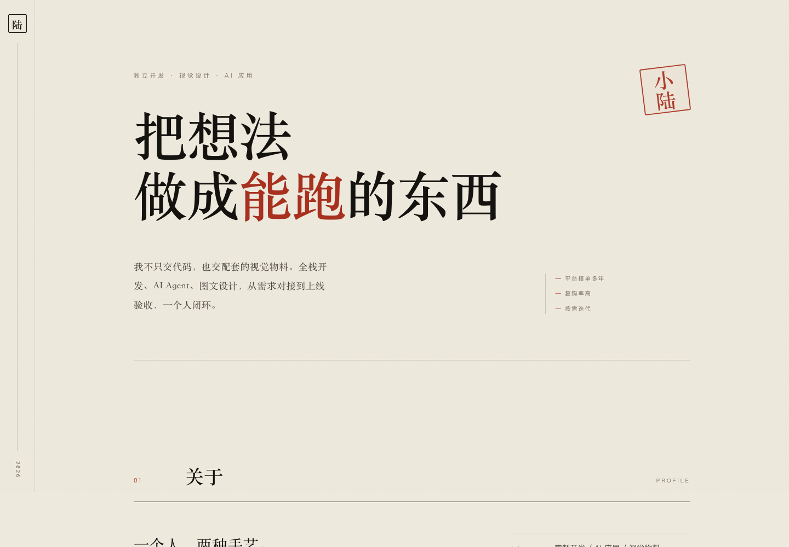
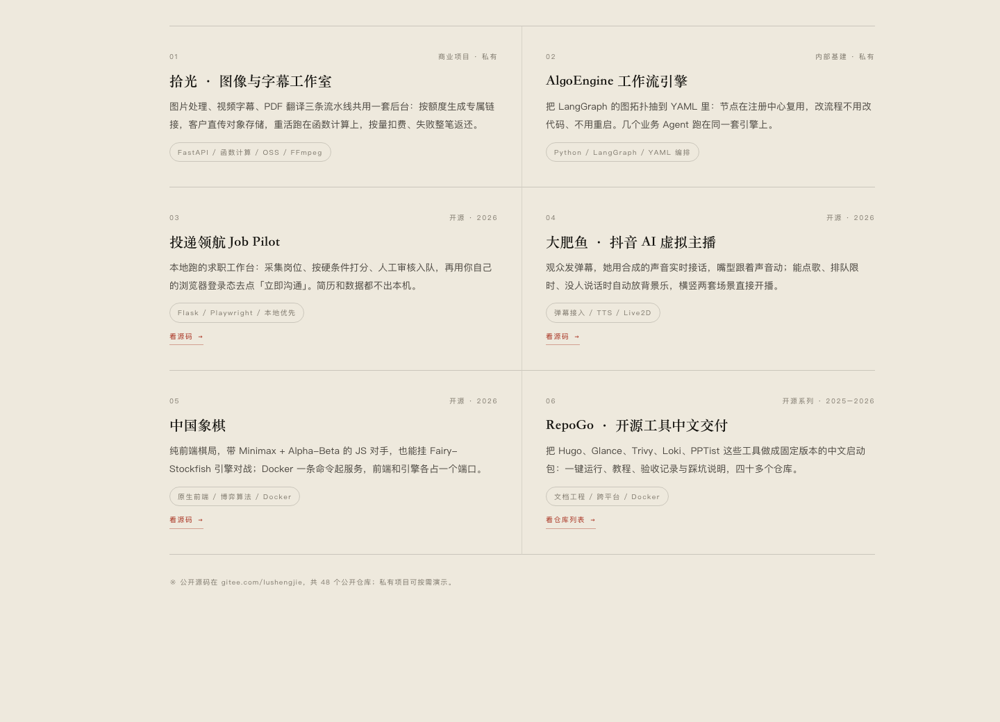
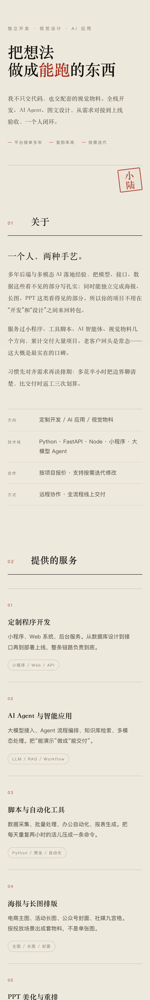

# 小陆的全栈工坊 · 官网

一个纯静态单页站：全栈开发 / AI Agent / 图文视觉的个人介绍与案例展示。

**在线地址：<https://47.117.247.11/shop>**



## 特点

- **零依赖**：没有框架、没有 CDN、没有外部字体，全部系统字体（中文用 Songti SC / Noto Serif CJK SC）
- **三个文件**：`index.html` + `assets/style.css` + `assets/app.js`，压缩前合计约 28 KB
- **纸感排印**：米白纸色 + 墨黑 + 朱砂，SVG `feTurbulence` 噪点做纸纹，左侧书脊导航
- **响应式**：桌面双栏、手机单栏，390px 起无横向溢出
- **动效可降级**：滚动进场用 IntersectionObserver，`prefers-reduced-motion` 下自动关闭
- **安全头**：CSP、`X-Frame-Options`、`Referrer-Policy`、`nosniff`，并由 nginx 做 20 r/s 限流

## 结构

- `index.html` — 整页结构与文案
- `assets/style.css` — 全部样式
- `assets/app.js` — 滚动进场动效
- `docs/` — 本 README 用到的截图

页面共六节：01 关于 · 02 提供的服务 · 03 做过的东西 · 04 怎么合作 · 05 为什么找我 · 06 聊聊你的项目。

## 本地预览

```bash
python3 -m http.server 8080
# 打开 http://127.0.0.1:8080
```

## 部署

静态托管在阿里云 ECS 的 nginx 上，走 IP 路径 `/shop/`：

```nginx
location = /shop { return 301 /shop/; }

location ^~ /shop/ {
    alias /var/www/shop/;
    index index.html;
    limit_req zone=shop_zone burst=40 nodelay;
}
```

同一个 `location` 里再追加响应头：`Cache-Control: no-cache`、`X-Content-Type-Options: nosniff`、
`X-Frame-Options: SAMEORIGIN`、`Referrer-Policy: strict-origin-when-cross-origin`，
以及 CSP —— 只允许自身资源、内联样式和数据 URL 图片。

```bash
rsync -av -e "ssh -i ~/.ssh/ecs_image_studio" ./ root@47.117.247.11:/var/www/shop/
ssh -i ~/.ssh/ecs_image_studio root@47.117.247.11 'chmod -R a+rX /var/www/shop'
```

文件必须对 `www-data` 可读，`scp` 落地默认是 600，会 403。

## 做过的东西



## 移动端



## 说明

Gitee Pages 已停止服务，所以页面没有托管在 Gitee 上，而是放在自己的服务器；
本仓库用于保存源码与展示截图。
